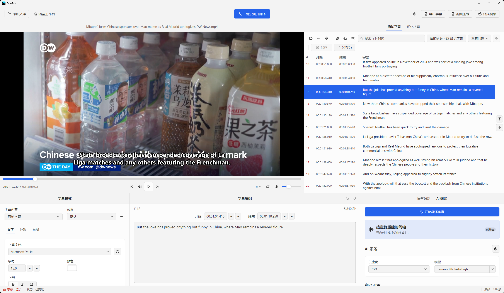
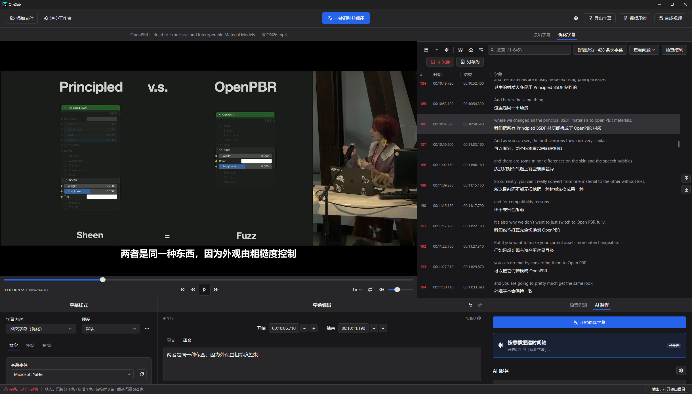
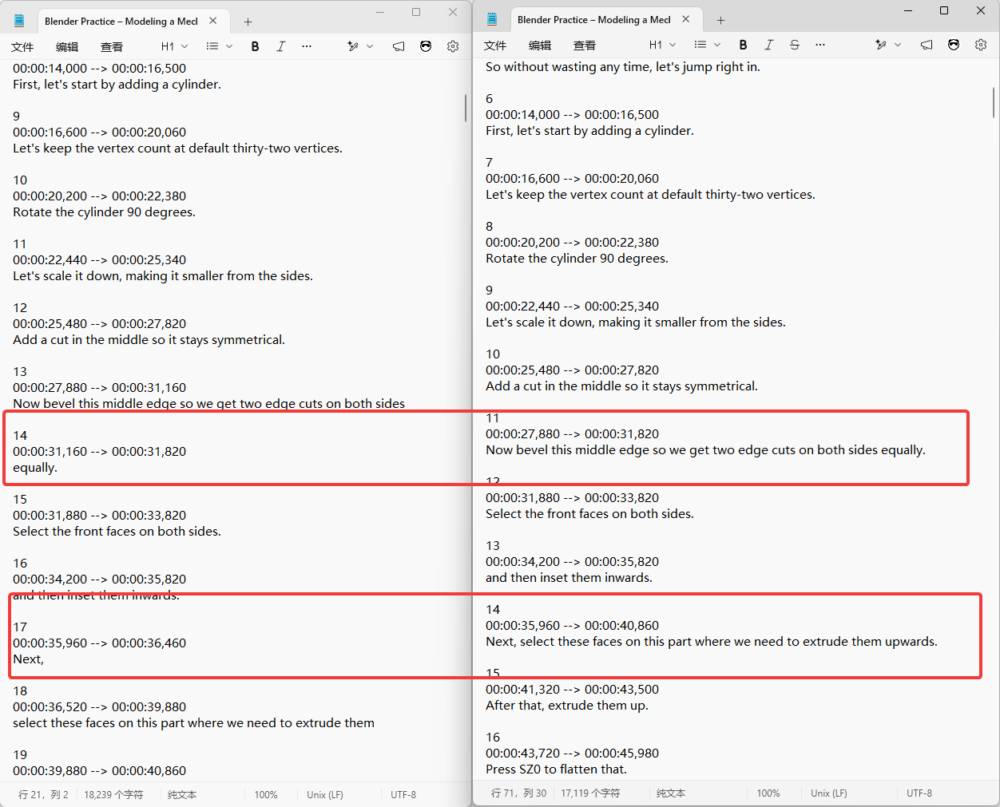

# OneSub

Local-first subtitle workbench: recognize, split, translate, edit, compress, and burn in

[License: AGPL-3.0-or-later](LICENSE)

[简体中文](README.md) | English

 

## What OneSub is

OneSub imports media, recognizes speech, translates, edits, previews, and exports subtitles in one workbench. Traditional subtitle translators translate the source lines as they are. Source lines often cut one sentence into several cues. The translation keeps these cuts, and the timeline goes wrong. OneSub regroups the dialogue into sense groups first. It then aligns the text to word-level time evidence. The original track stays separate from the rebuilt track.

Recognition, editing, and export need no cloud account. Translation uses the AI service that you configure.

## Interface and video preview

### OneSub workbench

### Rebuild timing by sense groups: before and after

Enable "Rebuild timing by sense groups" to merge isolated words and short fragments into complete sense groups. OneSub then adjusts cue boundaries from the source timing. Complete thoughts help the model translate more accurately.

**Left: disabled. Right: enabled.** On the left, `equally.` has its own cue and appears for only 660 milliseconds. On the right, it joins the previous sentence. The complete cue runs from `00:00:27,880` to `00:00:31,820`. OneSub also joins `Next,` to the instruction that follows.

OneSub saves the result in the rebuilt track and keeps the original track separate. With word-level timing, it aligns boundaries to real words. Without word-level timing, it only merges existing cues. We strongly recommend this option with `gpt-6-luna` or a model of equal or greater capability.

### Video demo

https://github.com/user-attachments/assets/64fed7da-2e36-48a5-8409-68cfbcf6a299

Demo conditions: 42-minute source video; Qwen3-ASR 1.7B recognition model; `gpt-6-luna` AI model; "Rebuild timing by sense groups" enabled. Recognition and translation took 6 minutes in this run. The demo runs at increased speed. Actual time depends on hardware, network, and service.

## Key features

Workflow: **Import → Recognize → Rebuild timing → Translate and review → Preview and deliver**.

### Subtitle structure and timing

- **Rebuild timing by sense groups**: Merge isolated words and short fragments before translation. Align boundaries to real words when timing is available. Merge existing cues when word timing is missing.
- **Smart split**: Split long cues with one click. Use the context menu for one cue. Use real word timing when available. Mark estimated cuts for timing review. Keep compact sentences unchanged. Undo a batch in one step.
- **Punctuation handling**: Process translated punctuation locally. Add no request and change no prompt. Remove or keep final punctuation. Convert sentence periods when needed. Protect email addresses, URLs, numbers, abbreviations, file names, and ellipses.
- **Separate tracks**: Keep original, rebuilt, and translated tracks independent. Edit, export, and undo each track. AI does not overwrite locked manual edits.

### Translation and review

- **Controlled translation**: Use full-video context, locked terms, and per-cue checks. Never fill a missing translation with source text. Protect negation, numbers, units, and literal strings.
- **Resumable translation**: Keep completed batches after an interruption. Retry only the missing content.
- **Format protection**: Import SRT, VTT, ASS, and SSA. Keep ASS layout. Export plain TXT without cue numbers, timestamps, or styling.

### Recognition and batch processing

- **Multi-engine local recognition**: Use SenseVoiceSmall, Paraformer-zh, Parakeet-TDT v3, and Qwen3-ASR. Detect the source language, then select a matching model. Models download on demand with resume and SHA-256 checks.
- **Silence protection**: Filter silence with VAD first. Long silence creates no false cues.
- **File queue**: Transcribe many audio or video files. Retry failed items alone.
- **Auto link**: Drop a video to load its same-name subtitle. Drop a subtitle to link its same-name video. Score language suffixes and small name differences.

### Media and delivery

- **Subtitles alone**: No video needed. Import subtitles to edit, translate, and export.
- **Video compression alone**: No subtitle needed. Encode H.264 into MP4 or MKV. Keep audio and chapters. Never overwrite the source video.
- **Shared preview and output**: Preview and composition use one subtitle, style, and font configuration. Support soft subtitles (muxed) and hard subtitles (burned in).
- **Chinese and English interface**: Support light and dark themes.

## Differences from traditional subtitle translators

| Item | Traditional tools | OneSub |
| --- | --- | --- |
| Segmentation | Keeps source segments | Regroups by sense group; cuts fall on word boundaries |
| Timeline | Inherited per line; translation drifts from speech | Aligned to word-level time evidence |
| Original subtitle | Overwritten by the translation | Original, rebuilt, and translated tracks stay separate |
| Failed translation | Often filled with the source text | Never filled; missing items are retried and flagged |
| Manual edits | Lost on re-translation | Locked content is never overwritten by AI |
| Speech recognition | Cloud service or one model | Local multi-engine with language detection |
| Silence | May produce hallucinated cues | VAD filter; no cues in long silence |
| Punctuation | Inconsistent in translation | Local rules; protected items stay unchanged |
| Preview vs. output | Styles differ | Shared configuration |
| Workflow | Create a project, then move through several pages | Drop a file and play; recognize, translate, and burn in on one workbench |
| Privacy | Often uploads media | Recognition runs on your computer; only subtitle text goes to the AI service you choose |

## Download

Download `OneSub-0.1.0-Setup.exe` from [Releases](https://github.com/OUBIGFA/OneSub/releases). Check the SHA-256 on the same page, then run it.

- Version 0.1.0, Windows x64 only. The installer is not Windows Authenticode-signed. Windows may show a security prompt.
- See the Release asset for the installer size. Recognition models download on demand. They range from several hundred MB to several GB. You can change the location.

## System requirements

- Windows 11, or a verified Windows 10 x64
- WebView2 runtime (the installer installs it)
- Recognition currently runs on the CPU

## Quick start

1. Drop a video into the window. It plays at once.
2. Click "One-click transcribe & translate". On first use, follow the prompts to choose a recognition model and set up an AI service.
3. Edit in the subtitle list and the edit panel.
4. Click "Export subtitles", or click "Compose video".

Subtitles only: drop the subtitle file, then edit and translate. Video only: click "Compress video".

## Recommended settings

| Item | Value | Reason |
| --- | --- | --- |
| Video encoding | CRF 23 | Small file, enough quality for most videos |
| Translation concurrent batches | 2 to 5 | A higher number may hit service rate limits |
| Cues per batch | 50 | Balances context and stability |
| Rebuild timing by sense groups | Strongly recommended with a model at or above gpt-6-luna | More reliable translation and a better timeline |

A weaker model may fail to return stable segmentation. Turn the option off in that case.

## Get gpt-6-luna usage with a ChatGPT account

1. Register a ChatGPT account and sign in to Codex.
2. Proxy that sign-in with [CLIProxyAPI (CPA)](https://github.com/router-for-me/CLIProxyAPI) or [magpie](https://github.com/yetone/magpie-releases). You get a local OpenAI-compatible address.
3. In OneSub settings, add an AI service. Enter that address and select the model `gpt-6-luna`.

OneSub supports the OpenAI Chat Completions and Responses protocols. CPA and magpie are third-party projects and are not affiliated with OneSub. OpenAI decides the available quota, limits, and terms. They can change at any time. Read the terms before you use them.

## Agent workflows

Copy the client configuration from Settings → MCP server to let agents transcribe, translate, read, edit, check and convert subtitles, then compose videos

The server uses your saved models, translation service and styles, and writes new files; see the [MCP guide](apps/desktop/MCP.md) for tool parameters and workflow examples

## License and credits

This project is released under **AGPL-3.0-or-later**. See [LICENSE](LICENSE). Third-party code, fonts, and models follow their own licenses. They are registered in the [third-party rules](third_party/README.md).
