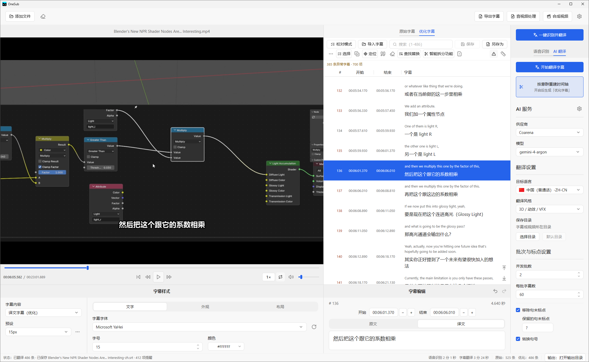
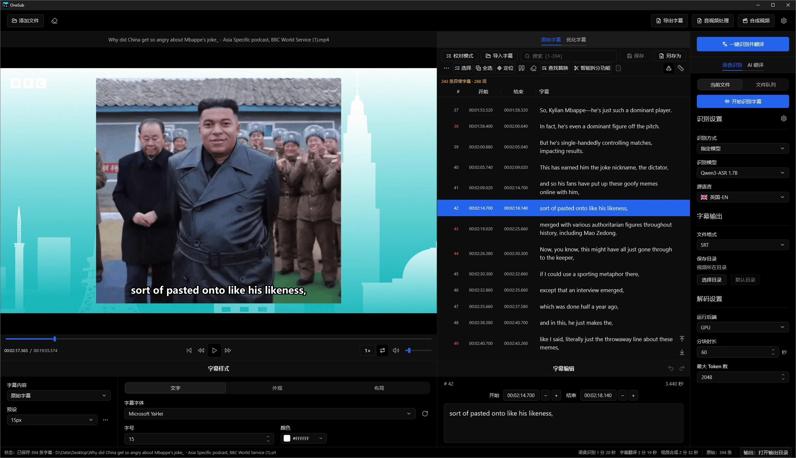
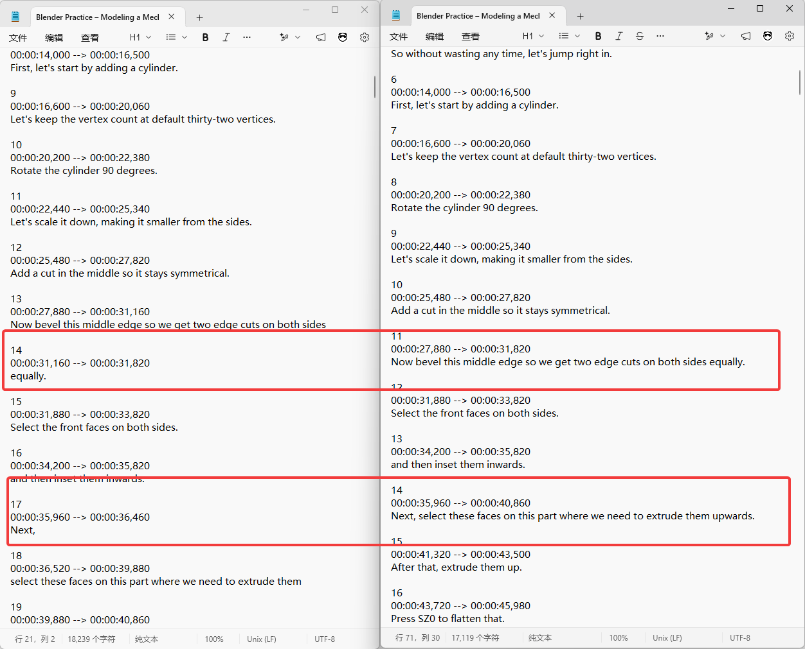

# OneSub

Local-first subtitle workbench: transcribe, split, translate, proofread, process media, and export

[License: AGPL-3.0-or-later](LICENSE)

[简体中文](README.md) | English

 

## What OneSub is

OneSub imports media, transcribes speech, translates, edits, previews, and exports subtitles in one workbench. Traditional subtitle tools translate source lines one by one. Source segments often cut one sentence into several cues. The translation keeps those cuts, and the timeline goes wrong. OneSub regroups dialogue into sense groups first. It then aligns text to word-level time evidence. OneSub keeps the original and optimized subtitle tracks separate.

Local recognition, editing, and export need no cloud account. Translation uses the AI service that you configure.

## Interface and video preview

### OneSub workbench

### Rebuild timing by sense groups: before and after

Enable "Rebuild timing by sense groups" to merge isolated words and short fragments into complete sense groups. OneSub then adjusts cue boundaries from the source word timing. Complete thoughts help the model translate more accurately.

**Left: disabled. Right: enabled.** On the left, `equally.` stands alone for only 660 milliseconds. On the right, it joins the previous sentence. The complete cue runs from `00:00:27,880` to `00:00:31,820`. OneSub also joins `Next,` to the instruction that follows.

OneSub saves the result in "Optimized subtitles" and keeps "Original subtitles" separate. When word timing exists, OneSub aligns boundaries to real words. Without word timing, it only merges existing cues. Enable this option when you use `gpt-6-luna` or a stronger model.

### Video demo

[Watch the 33-second video demo on Bilibili](https://www.bilibili.com/video/BV19asP6PE1c/)

## Key features

Workflow: **Import → Transcribe → Rebuild timing → Translate and review → Preview and deliver**.

### Subtitle structure and timing

- **Rebuild timing by sense groups**: Merge isolated words and short fragments before translation. Align boundaries to real words when timing exists. Merge existing cues when word timing is missing.
- **Smart split**: Split long cues by language reading load with one click or per cue. Estimate missing word cuts and mark them "Check timing". Keep compact sentences unchanged. Undo a batch in one step.
- **Punctuation handling**: Clean translated punctuation locally without extra API requests. Remove or keep final punctuation, or change sentence periods to commas. Keep email addresses, URLs, numbers, abbreviations, file names, and ellipses unchanged.
- **Separate tracks**: Keep original, optimized, and translated tracks independent. Edit, save, export, and undo each track. AI never overwrites locked manual edits.

### Translation and review

- **Controlled translation**: Use full-video context, custom glossaries, and per-cue checks. Never fill missing translations with source text. Protect negation, numbers, units, and literal strings.
- **Styles and credentials**: Choose from 8 built-in domain styles or add custom `SKILL.md` styles. Save API keys in Windows Credential Manager.
- **Resumable translation**: Keep completed batches after an interruption. Retry, locate, or skip remaining untranslated cues.
- **Retranslation and proofreading**: Retranslate selected cues with surrounding context and compare results side by side. Use literal find and replace, issue locator, proofreading mode, and a draggable length guide.
- **Format protection**: Import SRT, VTT, ASS, and SSA while keeping ASS layout. Export original, optimized, translated, or bilingual subtitles, or plain TXT without timestamps.

### Recognition and batch processing

- **Multi-engine local recognition**: Run Qwen3-ASR (0.6B/1.7B, FP16/INT8, GPU or CPU) and sherpa-onnx models (SenseVoiceSmall, Paraformer-zh, Parakeet-TDT v3 on CPU).
- **Alignment and hotwords**: Qwen3-ForcedAligner-Ultra is the default aligner. Qwen Chinese and English recognition supports hotwords with the optional SenseVoiceSmall helper model.
- **Smart routing and vocal separation**: Detect spoken language automatically and pick a matching model. Separate vocals with HTDemucs before Qwen3-ASR recognition when needed.
- **Silence protection**: Filter silence and pure music with FireRedVAD (VAD and AED). Long silence creates no false cues.
- **Model management and queue**: Download models on demand with resume and SHA-256 checks. Batch transcribe multiple audio or video files and retry failed items alone.
- **Auto link**: Drop a video to load its same-name subtitle. Drop a subtitle to link its same-name video. Match language suffixes and small name differences by score.

### Media and delivery

- **Subtitles alone**: Import subtitles without a video to edit, translate, check, and export.
- **Media tools**: Compress video to MP4 or MKV without subtitles. Choose CPU (SVT-AV1), CPU (H.264), or GPU. Keep audio tracks and chapters without overwriting source files. Extract the first audio track to MP3, M4A, AAC, WAV, FLAC, OGG, or Opus.
- **Consistent preview and output**: Preview real-time ASS styles with JASSUB using 9 presets, custom presets, bilingual styles, and glyph checks. Export soft subtitles (muxed) or hard subtitles (burn-in with any of the three encoding options), test a 5-second sample, or run in background.
- **Bilingual interface**: Switch between Chinese and English interfaces, light and dark themes, and tray mode.
- **Storage cleanup**: Use Settings → Storage to inspect and clear caches, logs, partial downloads and past projects. Current and pending projects, source files, exports and complete models are kept.

## Differences from traditional subtitle translators

| Item | Traditional tools | OneSub |
| --- | --- | --- |
| Segmentation | Keeps source cuts | Regroups by sense group; cuts on word boundaries |
| Timeline | Inherits lines; translation drifts from speech | Aligns text to word-level time evidence |
| Original subtitle | Overwritten by translation | Keeps original, optimized, and translated tracks separate |
| Failed translation | Often fills source text | Never fills source text; retries and flags missing items |
| Manual edits | Lost on re-translation | AI never overwrites locked edits |
| Speech recognition | Cloud service or one model | Local multi-engine with auto language detection and GPU/CPU support |
| Silence | May produce hallucinated cues | FireRedVAD (VAD and AED) filters silence and pure music |
| Punctuation | Inconsistent in translation | Applies local rules; keeps protected items unchanged |
| Preview vs. output | Styles differ | Uses one shared style, font, and subtitle configuration |
| Workflow | Create a project, then switch pages | Drop media and play; transcribe, translate, and export on one workbench |
| Privacy | Often uploads media | Runs recognition locally; sends only subtitle text to your chosen AI service |

## Download

Download `OneSub-0.1.3-Setup.exe` from [Releases](https://github.com/OUBIGFA/OneSub/releases), then run the installer.

- Version 0.1.3, Windows x64 only. The installer has no Windows Authenticode signature, so Windows may show a security prompt.
- Check the Release page for the installer size. Download recognition models on demand (several hundred MB to several GB). You can change the model folder.

## System requirements

- Windows x64 (Windows 10 compatibility depends on WebView2 and bundled dependencies)
- WebView2 runtime (the installer installs it automatically)
- Qwen3-ASR supports GPU (auto-detected) and CPU; SenseVoiceSmall, Paraformer-zh, and Parakeet-TDT v3 run on the CPU

## Quick start

1. Drop a video into the window. It plays immediately.
2. Click "One-click transcribe & translate". Follow the prompts to choose a recognition model and add an AI service.
3. Edit and review cues in the subtitle list and editor panel.
4. Click "Export subtitles", or click "Export video".

Subtitles only: drop a subtitle file to edit and translate. Media only: click "Media tools" to compress video or extract audio.

## Recommended settings

| Item | Value | Reason |
| --- | --- | --- |
| CPU (SVT-AV1) | High quality for everyday work; Near-lossless when needed for archives | Favors quality and small files; analyzes samples before encoding and takes longer |
| CPU (H.264) | CRF 20 by default for subtitle exports; CRF 23 for compression | Starts encoding without sample analysis; choose CRF 18, 20, or 23; lower values preserve more detail and produce larger files |
| GPU | Choose Near-lossless, High quality, or Compact as needed | Uses supported graphics hardware; selects AV1 when available or HEVC otherwise; files may be larger at similar quality |
| Translation concurrent batches | 2 to 5 | Higher values may hit service rate limits |
| Cues per batch | 50 | Balances context and stability |
| Rebuild timing by sense groups | Enable with gpt-6-luna or stronger models | Improves translation accuracy and cue timing |

Video compression and hard subtitle exports offer two CPU options and one GPU option, with saved choices. CPU (SVT-AV1) and GPU analyze samples and stop if the estimated reduction is too small. CPU (H.264) encodes directly without estimating size savings. Re-encoding does not guarantee smaller files. Export a five-second preview to check the result. Quality choices across encoders are not directly equivalent.

Turn off "Rebuild timing by sense groups" if a weaker model fails to return stable segments.

## Get free API access

<https://blog.bigfa.cc.cd/posts/2026053112195521/>

## Get gpt-6-luna usage with a ChatGPT account

1. Register a ChatGPT account and sign in to Codex.
2. Proxy that sign-in with [CLIProxyAPI (CPA)](https://github.com/router-for-me/CLIProxyAPI) or [magpie](https://github.com/yetone/magpie-releases) to get a local OpenAI-compatible endpoint.
3. Open OneSub settings, add an AI service, enter the endpoint, and select `gpt-6-luna`.

OneSub supports the OpenAI Chat Completions and Responses protocols. CPA and magpie are third-party projects with no affiliation to OneSub. OpenAI controls quota, limits, and terms, and can change them at any time. Read the terms before use.

## Agent workflows

Copy the client configuration from Settings → MCP server. Agents can then transcribe, translate, read, edit, check, and convert subtitles, and export videos.

The MCP server uses your saved models, translation service, and styles, and writes new files. See the [MCP guide](apps/desktop/MCP.md) for parameters and workflow examples.

## License and credits

OneSub uses the **AGPL-3.0-or-later** license. See [LICENSE](LICENSE). Third-party code, fonts, and models follow their own licenses. See [third-party rules](third_party/README.md) for registered components.
