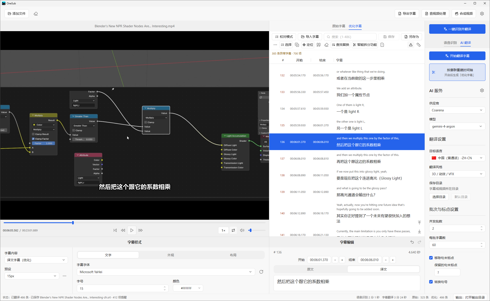
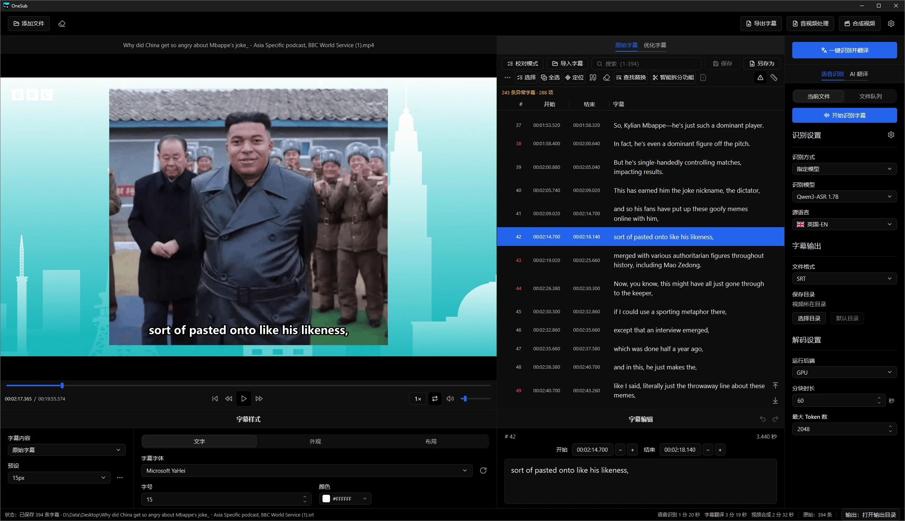
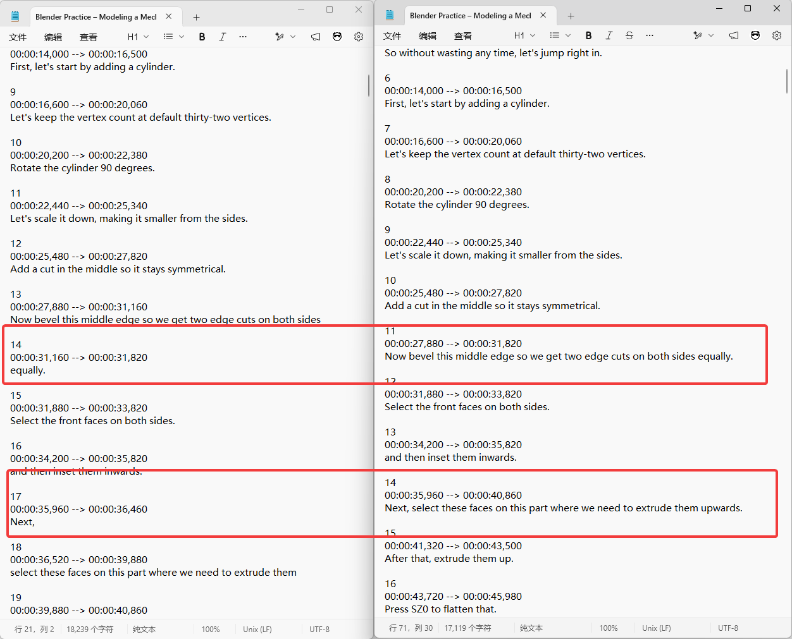

# OneSub

本地优先的智能字幕工作台：识别、拆分、翻译、校对、处理音视频、合成

[开源协议：AGPL-3.0-or-later](LICENSE)

简体中文 | [English](README.en.md)

 

## OneSub 是什么

OneSub 在一个工作台内完成导入、识别、翻译、校对、预览和导出。传统字幕翻译工具按原始分段逐行翻译。原始分段常把一句完整的话切成多条，译文继承这些切点，时间轴也随之错位。OneSub 先按意群重建分段，再把文字对齐到词级时间证据。OneSub 独立保留原始字幕与优化字幕。

本地识别、编辑和导出不需要云账号。翻译使用你自己配置的 AI 服务。

## 界面与视频预览

### OneSub 工作台

### 按意群重建时间轴：前后对比

开启“按意群重建时间轴”后，OneSub 先把孤词和短句片段合并为完整意群，再按原始词级时间调整字幕边界。完整语义帮助模型更准确地翻译。

**左侧未开启，右侧已开启。** 左侧的 `equally.` 单独占一条字幕，仅显示 660 毫秒。右侧把它并回前句，整句时间为 `00:00:27,880 → 00:00:31,820`。`Next,` 也与后续操作说明合并，不再单独闪现。

OneSub 将重建结果存入“优化字幕”，并独立保留“原始字幕”。存在词级时间时，边界对齐到真实词语。缺少词级时间时，仅合并已有条目。使用 `gpt-6-luna` 或更强模型时，建议开启此功能。

### 视频演示

[前往 Bilibili 观看视频演示（33 秒）：免费开源 OneSub：本地识别、AI 翻译、校对、压制一站搞定](https://www.bilibili.com/video/BV19asP6PE1c/)

## 主要特点

工作流程：**导入 → 识别 → 整理时间轴 → 翻译校对 → 预览交付**。

### 字幕与时间轴

- **按意群重建时间轴**：在翻译前合并孤词和短句片段。存在词级时间时，将边界对齐到真实词语。缺少词级时间时，仅合并已有条目。
- **智能拆分**：按字幕语言的阅读负荷，一键或单条拆分过长字幕。缺少词级时间时估算切点，并标为“待校时”。紧凑整句无安全切点时保持原样。支持整批撤销。
- **标点处理**：在本地处理译文标点，不增加 API 请求。可移除或保留句末标点，也可把句号转为逗号。邮箱、网址、数字、缩写、文件名和省略号保持不变。
- **独立字幕轨**：原始字幕、优化字幕与译文彼此独立。每条轨道都支持编辑、保存、导出和撤销。AI 不覆盖已锁定的人工修改。

### 翻译与校对

- **受控翻译**：使用全片上下文、自定义术语表和逐条校验。译文缺失时不填充原文。保护否定、数值、单位和字面串。
- **翻译风格与凭据安全**：内置 8 种领域风格，支持自定义 `SKILL.md` 风格。API Key 存入 Windows 系统凭据管理器。
- **中断可续**：翻译中断后保留已完成批次。可定位、重试或跳过未翻译字幕。
- **重译对比与校对工具**：支持勾选单条或多条字幕带上下文重译，并排对比新旧译文后替换。内置查找替换、异常字幕定位、校对模式和可拖动长度参考线。
- **格式保护**：导入 SRT、VTT、ASS 和 SSA，并保留 ASS 原排版。可导出单语或双语字幕，以及不含序号、时间轴或样式的 TXT 纯文本。

### 识别与批处理

- **多引擎本地识别**：支持 Qwen3-ASR（0.6B/1.7B，FP16/INT8，GPU 或 CPU）以及 sherpa-onnx（SenseVoiceSmall、Paraformer-zh、Parakeet-TDT v3，CPU）。
- **精确对齐与热词**：默认使用 Qwen3-ForcedAligner-Ultra。Qwen 中英文识别可填写热词，需下载 SenseVoiceSmall 辅助模型。
- **智能路由与人声分离**：自动检测源语言并选择对应模型。使用 Qwen3-ASR 时，可选用 HTDemucs 先分离人声。
- **静音保护**：先用 FireRedVAD（VAD 与 AED）过滤静音与纯音乐。长静音不生成假字幕。
- **模型管理与文件队列**：模型按需下载，支持断点续传、SHA-256 校验与自定义目录。支持批量识别音视频队列，失败项可单独重试。
- **双向自动关联**：拖入视频自动加载同名字幕，拖入字幕自动关联同名视频。按权重匹配语言后缀和少量名称差异。

### 媒体与交付

- **纯字幕模式**：无需视频，直接导入字幕完成编辑、翻译、检查和导出。
- **音视频处理**：无需字幕即可压缩视频（H.264 编码 MP4 或 MKV，CRF 18/20/23），保留音轨与章节且不覆盖源文件。支持提取首条音轨为 MP3、M4A、AAC、WAV、FLAC、OGG 或 Opus。
- **预览与合成一致**：使用 JASSUB 实时预览 ASS 效果，提供 9 套内置预设、自定义预设、双语独立样式和缺字检查。支持软字幕（封装）与硬字幕（烧录），可先导出 5 秒预览或在后台合成。
- **双语界面与托盘**：支持中英文界面、深浅色主题及最小化到托盘。
- **存储清理**：在“设置 → 存储”查看并清理缓存、日志、下载残留和历史项目。保留当前及待续项目、原始媒体、导出文件和完整模型。

## 与传统字幕翻译软件的差异

| 项目 | 传统软件 | OneSub |
| --- | --- | --- |
| 分段 | 沿用原始分段 | 按意群重新分段，切点落在词边界 |
| 时间轴 | 按行继承，译文与语音错位 | 对齐词级时间证据 |
| 原始字幕 | 被译文覆盖 | 原始、优化、译文三轨独立 |
| 翻译失败 | 常以原文填充 | 不填充原文，重试并标出缺失项 |
| 人工修改 | 重新翻译时丢失 | AI 不覆盖已锁定的人工修改 |
| 语音识别 | 依赖云服务或单一模型 | 本地多引擎，支持自动检测语言和 GPU/CPU |
| 静音 | 可能产生幻觉字幕 | FireRedVAD（VAD+AED）过滤静音与纯音乐 |
| 标点 | 译文标点混乱 | 本地规则处理，受保护项不变 |
| 预览与成片 | 样式不一致 | 预览与合成共用样式、字体和字幕配置 |
| 工作流 | 先建工程，分多个页面 | 拖入即播放，识别、翻译、合成在同一工作台 |
| 隐私 | 常需上传媒体 | 识别在本机运行；只把字幕文本发给你选的 AI 服务 |

## 下载

从 [Releases](https://github.com/OUBIGFA/OneSub/releases) 下载 `OneSub-0.1.1-Setup.exe`，然后运行安装器。

- 版本 0.1.1，仅支持 Windows x64。安装器未添加 Windows Authenticode 签名，系统可能显示安全提示。
- 安装器大小见 Release 页面。识别模型按需下载，体积从数百 MB 到数 GB，保存位置可改。

## 系统要求

- Windows x64（Windows 10 兼容性取决于 WebView2 和随包依赖的支持范围）
- WebView2 运行时（安装器自动安装）
- Qwen3-ASR 支持 GPU（自动检测）和 CPU；SenseVoiceSmall、Paraformer-zh 和 Parakeet-TDT v3 使用 CPU

## 快速开始

1. 把视频拖入窗口。视频立即可播放。
2. 点击“一键识别并翻译”。按提示选择识别模型并配置 AI 服务。
3. 在字幕列表和字幕编辑区校对。
4. 点击“导出字幕”，或点击“合成视频”。

只有字幕时：拖入字幕文件，直接校对和翻译。只需处理音视频时：点击“音视频处理”，选择压缩视频或提取音频。

## 建议参数

| 项目 | 建议值 | 说明 |
| --- | --- | --- |
| 视频编码 | CRF 23 | 兼顾体积与画质，适合多数视频 |
| 翻译并发批数 | 2 到 5 | 过高易触发服务限流 |
| 每批字幕数 | 50 | 兼顾上下文与稳定性 |
| 按意群重建时间轴 | 使用 gpt-6-luna 或更强模型时开启 | 提升译文准确度与时间轴合理性 |

较弱的模型无法稳定输出分段结果时，关闭“按意群重建时间轴”。

## 免费获取 API

<https://blog.bigfa.cc.cd/posts/2026053112195521/>

## 用 ChatGPT 账号获得 gpt-6-luna 用量

1. 注册 ChatGPT 账号，并登录 Codex。
2. 使用 [CLIProxyAPI（CPA）](https://github.com/router-for-me/CLIProxyAPI) 或 [magpie](https://github.com/yetone/magpie-releases) 反向代理该登录，获取本地 OpenAI 兼容地址。
3. 打开 OneSub 设置，添加 AI 服务，填入该地址并选择 `gpt-6-luna`。

OneSub 支持 OpenAI Chat Completions 与 Responses 协议。CPA 与 magpie 是第三方项目，与 OneSub 无关联。OpenAI 决定可用额度、限制和使用条款，且可能随时变更。使用前请阅读相关条款。

## 智能体调用

在设置的「MCP 服务」页复制客户端配置。智能体即可调用本地识别、翻译、字幕读取、编辑、检查、格式转换和视频合成功能。

MCP 服务使用已保存的模型、翻译服务和样式配置，并输出新文件。工具参数与编排示例见 [MCP 使用说明](apps/desktop/MCP.md)。

## 许可与致谢

本项目使用 **AGPL-3.0-or-later** 协议。完整文本见 [LICENSE](LICENSE)。第三方代码、字体与模型各自遵循其许可证。已登记组件见 [第三方依赖规则](third_party/README.md)。
