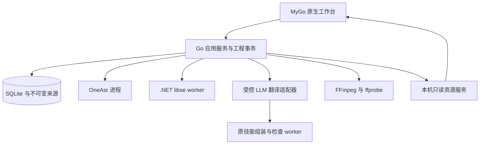

# 技术架构与数据契约

状态：实施设计 · 2026-10-27

## 1. 技术选型与责任

| 边界 | 选择 | 约束 |
| --- | --- | --- |
| 桌面容器与主界面 | MyGo 原生 `ui`，Go | 直接使用原生控件、布局、主题、图标承载和托盘；不另建 React/HTML/CSS 工作台 |
| 媒体渲染视图 | MyGo 内嵌 WebView、HTMLVideoElement、JASSUB | 只承载真实媒体/ASS，不承载第二套操作界面；无法直接播放的输入建立预览代理 |
| 业务 | Go 应用服务、事务和任务调度 | 唯一工程写入者；前端不直接改数据库 |
| 字幕库 | Subtitle Edit/libse，.NET 10 自包含 worker | 直接编译引用锁定源码；禁用 trimming/NativeAOT 起步 |
| 本地识别 | 固定 OneAsr CLI/core | 复用推理内核；只维护有限集成补丁 |
| 翻译 | 应用内 LLM 适配器 + 受控字幕技能 | 首先支持经验证的 OpenAI 兼容 Chat Completions；不声称原技能自带 API SDK |
| 校验 | 原 Python 组装与检查代码，PyInstaller onedir worker | 开发用 Python，用户无需安装 Python；不替换技能规则 |
| 播放与渲染 | HTMLVideoElement、JASSUB、FFmpeg/libass | 共用冻结 ASS/字体；不承诺逐像素一致 |
| 存储 | SQLite，modernc.org/sqlite | 驱动及其 SQLite 实际版本一并锁定与安全核查 |

MyGo 研究快照 `go.mod` 明确要求 Go 1.27.3；libse 同时目标 `netstandard2.1;net10.0`，本项目选择 net10.0。依赖升级依据安全、构建和回归结果，不把研究快照永久等同发行版本。

下图是规划中的主调用与资源交付关系。箭头从调用方指向被调用组件；本机资源服务指向界面的箭头表示资源交付。图中省略返回值与进程内对象，具体契约见下文各节。



图中的进程隔离用于故障与接口边界，**不是安全沙箱，也不是许可证豁免**。工作进程仍有宿主用户权限，资源限制和输入校验不可省略。

服务划分为 Project、Subtitle、Asr、Translation、Style、Export、Settings。原生界面直接调用业务服务；内嵌媒体页仅绑定受限播放事件，不暴露工程写入、通用读文件、exec 或任意网络请求。媒体 WebView 在导入与任务期间保持同一实例和布局节点，原生层按媒体宽高比留黑边；进度仅覆盖画面，不卸载播放器。空画面也由完整原生覆盖层承接命中与拖放，不把首次导入交给网页导航。媒体切换带单调序号，旧命令和旧状态轮询不能覆盖新来源；JASSUB 更新同样丢弃过期异步结果。媒体解码错误与字幕渲染错误分开清除。原生 view 的状态变更通过 MyGo 主线程 Update，后台任务不持有一帧内的 ui.Element。

Windows 媒体 WebView 进程使用 `--disable-direct-composition` 避开运行时的陈旧视频裁切呈现问题：本机可复现 DOM 与原生视口尺寸正确、暂停首帧仍只显示局部，等待布局稳定及 CSS 合成层均无效。该参数仅在应用进程启动 WebView2 前追加，保留其他浏览器参数，不修改用户环境或禁用硬件解码、MyGo 原生渲染；不采用循环重载、自动播放或假首帧补偿。相关上游呈现问题参考 [WebView2Feedback #5574](https://github.com/MicrosoftEdge/WebView2Feedback/issues/5574) 与 [#5723](https://github.com/MicrosoftEdge/WebView2Feedback/issues/5723)，它们是排查依据，不代替本机回归；运行时升级后应重新评估此兼容选项。

### 1.1 统一导入与关联发现

P0 的拖放与文件选择都进入同一个 Go 导入应用服务。MyGo 原生拖放/选择器提供真实本地文件引用；前端不能仅凭 `File.name` 拼出路径。G0 验证两类入口能取得同样受限的本地访问能力，G1 完成双向配对。

一次导入先整理用户显式选择的文件并按实体去重，再查询各自同目录的候选。名称匹配遵循[产品方案](product-plan.md)，不依赖目录遍历顺序；发现与解析在后台进行，界面不阻塞。统一文件类型清单服务于拖放、选择器和自动发现，不能有三套扩展名判断。

输入有效后自动建立用户数据目录内的恢复工程并立即显示播放器/字幕列表，不要求先命名、选择工程位置或进入准备页。新输入只补齐缺失媒体/字幕时关联当前工程；替换内容先处理草稿，保存已有工程并创建新的恢复工程。正式另存位置是独立动作，失败不得丢失恢复工程。

导入结果包含用户选择、候选及 `matched/ambiguous/not_found/failed` 状态。唯一候选经实际字幕解析或 ffprobe 视频流确认后自动关联；多个候选由用户选择。主文件有效而候选失败时仍可完成单文件导入，错误状态单独保留。导入关联一次提交，不通过递归调用“打开另一类型文件”再次启动发现。

工程记录实际媒体引用、字幕来源和关联来源（用户指定/同名自动/工程恢复），并保存指纹。重开工程先恢复已保存的关联；替换现有内容先处理草稿与保存。加载候选前重新核对文件可读性及身份，发现期间的删除/移动不能变成成功状态。自动关联不代表时轴已校准，也不启动任何 AI 或联网任务。

## 2. 工程存储

```text
lesson.onesub/
  project.json        # schema、工程 ID、相对媒体引用、应用版本
  project.sqlite      # cues、tracks、revisions、jobs、glossary、issues
  originals/          # 原字幕、文稿与识别证据，只写一次
  artifacts/          # 已验收产物、检查报告与导出清单
  cache/              # 可重新生成的代理、波形与静帧
  logs/               # 轮转后的脱敏诊断
```

媒体默认外部引用，保存文件大小、mtime、采样指纹；关键重新关联或缓存确认使用完整 SHA-256。原文件变化触发“来源已改变”，不能只凭同名自动重用识别缓存。

SQLite 使用 WAL、foreign_keys、busy_timeout；成功编辑立即事务提交。`synchronous=FULL` 作为持久性起点，并测量交互延迟；若改为 NORMAL，必须明确掉电可能丢失最近提交的取舍，不继续承诺相同耐久性。备份使用 backup API/一致性快照，禁止 WAL 活动时只复制主文件。

活动工程只支持本地可靠文件系统；检测已知网络共享时拒绝可写打开并提供本地副本。对同步盘给强提醒和转存路径，不能承诺可识别所有同步软件。工程锁须核对 PID、启动时间和实例 ID；恢复不能仅因锁文件旧就抢占活进程。

迁移前备份；失败保留旧版本并以只读方式打开；更高 schema 版本默认只读，不尝试降级重写。包导出先冻结快照，按选项复制媒体和有权分发的字体；不带 Key、完整机器路径、缓存或无关日志。

### 2.1 修订、编辑与草稿

- `project_revision` 是工程级单调版本，批次候选基于它；cue 另有局部 revision。
- 命令携带 `command_id` 和 `expected_revision`；重复 command_id 返回已提交结果，不重复写入。
- 冲突返回 `REVISION_CONFLICT`，不给最后写入者静默覆盖权。
- 手势组用 before/after 差分保存触达的 cues、锁和样式；至少 200 组 undo/redo，不对每次按键复制两万条 cue。
- 字幕编辑在停止输入约 0.6 秒或离开当前字幕时提交为一次修订，可撤销；IME 组合输入结束前不提交。无效时间或文字保留在输入框并提示，离开该字幕时恢复原内容并说明原因。
- 工程修订是工作副本，字幕文件另行保存：写入字幕文件只经字幕列表的保存（Ctrl+S）或另存为，先写同目录临时文件再替换。每条轨道按内容 SHA-256 与最近一次保存比较，判断是否未保存。打开文件或工程、重新识别、清空工作台和退出前提供保存／不保存／取消；写入失败保留修改、阻止原动作。
- 源文与译文手改独立写入，原始字节不变；样式与偏好继续自动持久化。
- 已审状态绑定内容及时间 revision；内容变化须回到待审，不能沿用旧“已通过”。

### 2.2 独立字幕与翻译恢复

当前存储版本为 2。`source_cues` 保存原始字幕，`cues` 保存待处理或已重建的原文与译文。两套字幕仍完全一致时，原始字幕的手工修改同时更新待翻译副本；AI 重建后分别编辑，不互相改写。历史记录带轨道标识，撤销、重做只作用于该次修改涉及的轨道。不可变来源文件继续保留。

版本 1 工程升级前通过 SQLite `VACUUM INTO` 建立一致性备份；按历史恢复首次翻译前的原始分段，再事务性添加原始轨和历史标识。数据库提交后才更新工程清单；中途停止可继续完成清单更新。

`translation-progress.jsonl` 保存冻结输入、分段、上下文及增量文字。每条显示事件先写入并同步，再通知界面。末尾未写完的事件不影响此前记录；中间损坏明确报错。重试校验工程修订与输入指纹，已接受译文不重复请求。设置只保存恢复工程的位置，Key 继续留在 Windows 凭据管理器中。恢复应用不会自动向供应商发送请求。

字幕导出先选择时间轴，再选择文字：原始字幕使用原始轨；重建字幕、译文、双语使用重建轨。双语的两份文字来自同一组重建时间，不按原始行号与重建行号拼接。译文自动保存及列表保存只写译文，双语导出需显式选择。导出可另选上行或下行：字幕 worker 先用严格写入验证当前文档，再在独立副本提取每条字幕的第一行或最后一行；已有单行保留，不更改原工程及源文件，不放宽普通 ASS 编辑保护。预览、导出和合成共用 SmartSub 样式管线。

## 3. 统一时间与来源模型

内部时间使用相对工程播放零点的 `int64 start_ms/end_ms`，跨 JS 边界限制为安全整数。时间区间统一 `[start, end)`。保留源 time_base、有理 PTS、start_time、旋转、SAR/DAR 和色彩信息，VFR 不用平均帧率伪造时轴。

OneAsr 文件 timeline 的浮点秒在适配边界转为毫秒：

```text
project_ms = round(oneasr_seconds * 1000) + wav_zero_project_ms
wav_zero_project_ms = 实际 WAV 第一个样本的源 PTS - 工程零点的源 PTS
```

例如工程零点 -120 ms、WAV 首样本 -35 ms，偏移是 +85 ms；若 WAV 已补 85 ms 静音对齐，则偏移为 0，不能叠加两次。记录实际输入 WAV 哈希、音轨号和处理计划。时间戳不连续时保存分段映射，禁止候选跨越不连续边界。未知映射标记 `TIMEBASE_UNKNOWN`，需重建证据后导出定时结果；纯字幕工程使用其自有零点，不伪称已核对媒体同步。

规范 cue 至少有：稳定 cue_id、track_id、revision、start/end、原文修订引用、译文、source_ranges、timing_quality、speaker_id、kind、样式引用、锁和 issues。

- track 是语言/用途分轨；kind 区分 dialogue、sign、sound、comment，避免把标牌/音效当填充词删除。
- atom 是来源最小单位，有 timeline 时沿用对齐单元；没有词时间证据时整个 cue 是一个 atom。
- `timing_quality=aligned/cue_boundary/manual`；对齐器输出不是逐词置信验证，confidence 缺失为 null。
- 同一普通对白责任区每个 atom 按序恰好归属一次；多轨、多人真实重叠、ASS 层保留。
- 有意间隙不因主题相同而消失；跨 gap 必须记录具体接缝理由并重点审阅。
- 零/负时长、超出媒体范围、量化后 collapsed cue 阻止相应导出；不能拉长 1 ms 掩盖错误。

## 4. OneAsr 集成

### 4.1 已核查的接口边界

`transcribe` 使用 `--input --language --asr --aligner --backend --app-root --data-root`；`--chunk-seconds` 是识别分块目标，不是字幕显示时长。timeline 默认开启；`transcribe --output` 不代表整套 sidecar 都被搬走。`render` 使用 `--timeline --preset --output`，此处 output 是目录；`align` 使用 `--audio --text`，不能套用 transcribe 的参数。

上游 timeline v1 含 `version/media/lang/preset/vad_speech_segments/words`；词字段 `text/start/end`，单位秒，不含逐词 confidence、speaker 或 OneSub ID。`--words-json` 不能与 timeline schema 混用。

应用先用 FFmpeg 显式 `-map` 抽取选定音轨为 16 kHz 单声道 PCM WAV，再调用 OneAsr。选中第二音轨后仍把原片交给默认抽音逻辑属于错误。文稿 align 保留原换行，再 render 时传文稿；SRT 文稿输入不意味着旧时间码不变。

### 4.2 有限 patchset

只补：JSONL 机器协议、共享只读 models-root、FFmpeg 绝对路径、任务 UUID scratch、产物清单及 sidecar 写失败的非零退出。进度来自 StageUpdate，不解析本地化日志；模型/设备回退必须可见。每项补丁有上游 SHA、范围、测试与升级冲突记录。

模型训练、推理算法、VAD 重写和跨文件常驻服务不纳入 patchset。原版 CLI 可用于开发的不定进度验证，正式产品必须通过机器协议门禁。

默认 Qwen3-ASR 0.6B + CTC；1.7B、Qwen 对齐器、热词 SenseVoiceSmall 与 HTDemucs 都是显式可选下载。热词仅在引擎支持语言中启用；翻译术语不全量直接传 ASR。原版 CLI 内的 FireRedVAD 只用于连续分块，短片还可能跳过检测。OneSub 在识别输入前直接运行同版本 FireRedVAD `v1.0.0`：保留有语音的范围和必要边缘上下文，长静音不进入识别，字幕及词级时间再按片段偏移还原；全静音不启动 ASR 或翻译。模型、默认检测参数、二进制哈希、许可及适配边界见 [OneAsr 集成登记](../third_party/ports/oneasr/README.md)。

首版可用语言取引擎与对齐链路的交集，当前快照为 11 种；模型卡的 30 种语言/22 种方言不能直接变成 OneSub 的承诺。混合语言、口音和低信噪比列为质量风险，不默默改源语言。

## 5. 字幕解析与无损保护

libse worker 的基础操作为 capabilities、parse、serialize、convert、inspect、proposeFix、shift。使用自包含 .NET 10，并明确每个 RID 的 SkiaSharp native assets 与系统依赖。串行显式设置全局 Configuration，禁止跨工程污染。

worker 只返回 DTO、警告和提案，不写工程或覆盖输入。格式能力由应用实际验收白名单声明，底层支持更多格式不意味着 UI 默认开放。

- ASS/SSA 保留原始行/字段结构，仅在 Text 位置回填；不能完整重序列化后宣称非 Text 字节无损。
- 保护 `\pos`、`\N`、层、样式、Comment、未知 section、字体附件、绘图 `\p` 和 karaoke 标签。无语言内容的绘图事件不送模型；复杂标签无法安全回填时保持原事件并提示人工处理。
- 严格 ASS 导出保留其本来时长和有意重叠；新建普通对白 ASS 与严格翻译模式分开。
- VTT 保留 cue ID/settings、NOTE/STYLE/REGION、时间映射与受支持的内联时间/语音标记；未知结构列入转换报告，原文件仍保留。
- 编码检测低置信时先预览；逻辑文本可按约定 NFC，原始字节、ID、路径和受保护字面串不得随意规范化。
- 自动修复只生成 diff，经校验和用户接受后作为一个可撤销命令提交。

## 6. 翻译执行契约

完整技能目录以受控快照复用；权利人已授权自有内容采用 AGPL-3.0-or-later 随 OneSub 分发，第三方材料仍单独核查。桌面适配单独登记执行载体、路径、缓存、候选 schema 与落盘差异。原技能规定由 assistant 翻译、脚本只校验，本应用内助手属于明确的适配工作流，不把 Python 脚本冒充翻译 SDK。

装载链：SKILL.md → formats/segmentation/style-common → 目标语言/姓名/语言配置 → 技术表达规则 → 按需 3D 术语。保留全包，记录实际装载文件及哈希；不能只抄一个 Prompt。适配器不授予 shell、任意读写、网页浏览或网络工具能力。

规则优先：源事实和用户锁定字面串 > 技能格式/时间/覆盖约束 > 明确工程术语 > 风格措辞。工程术语可覆盖默认译名，不能覆盖事实。

### 6.1 候选、落时与提交

候选只包含 protocol、base_revision、region_id、segments、drops、uncertainties。segment 指定 first_atom/last_atom、优化原文、译文、接缝理由和纠错说明，不指定时间码。Go 展开有序闭区间检查越区、漏区、重复与归属；source_cue_ids 由注册表派生。

同一来源 cue 内分割以后一块首 atom start 为共享切点，保留责任区外侧边界，不用首尾词各自夹取造成新空洞；原 cue 间的有效 gap 保留。`drops` 仍属于某个输出 segment，只是删词建议，不释放时间，未确认不得提交。

没有内部 atom 的 cue 禁止模型细拆。候选 schema 不合法最多两轮修复，再保守边界重译或待人工；缺译不能回填原文冒充成功。跨 batch 接缝重算需合并责任区并撤销旧候选，不双重输出。

最后调用原 assemble/checker 检查完整结果。双语先独立检查源层和译层，再检查组合结构。导出错误阻止该目标交付，不阻止保存草稿、原始文件或诊断包；允许的警告保留说明，不伪装“全部通过”。

### 6.2 服务与预算

声明 provider 的 context window、最大输出、结构化输出能力与允许参数；不假设所有兼容接口支持 response_format、temperature 或同名 token 参数。基础 HTTP 仅接受用户选定端点，TLS 默认验证；自定义企业证书单独配置，不提供全局忽略证书开关。

源字幕/摘要作为独立数据消息，不能升格系统规则。默认每批不超过 30 cues，核心输入约 6000 tokens，前后各至多 5 cue 只读上下文；实际按规则文本、摘要、输出预留和 provider 限额缩批。

开始前显示服务、模型、发送内容类别、估算 tokens、单价来源与预算。每批先保留预计额度；并发在途费用、未知单价和服务端估算偏差须显示，不能宣称对第三方账单绝对封顶。默认并发 2。

429/503 遵从 Retry-After，有限退避；401/403/模型不存在不盲重试。发送后读超时可能已经计费，标记 outcome_unknown，用户确认后才重试；不自动改账号、端点或云服务。

缓存键包含完整输入、上下文、目标语、术语/风格/技能/适配器版本、端点标识、模型与参数；人工锁定内容不可被缓存回放覆盖。LLM 缓存为工程数据，不是可公开样例。

## 7. 媒体、字体和唯一渲染文档

ffprobe 建立 MediaTransform：尺寸、旋转、SAR/DAR、流时基、色彩/HDR、音轨偏移。位置保存为显示画面归一化坐标，ASS PlayRes 使用实际规范化画布，不写死 1920×1080。

直接播放失败则建立 720p SDR H.264/AAC 代理；代理只预览，不默认作为最终输出源。HDR 代理明确标为 SDR 近似，原片硬烧录在 P0/P1 拒绝。代理失败不影响仅字幕工作流。

本机资源服务绑定 `127.0.0.1` 随机端口，支持 Range/HEAD、短期能力令牌、注册 mediaId、MIME 和字节范围上限；不暴露绝对路径。检查 Host、真实应用 origin 和授权能力，防 DNS rebinding/目录穿越；媒体请求可能不带 Origin，不能仅靠 CORS 授权，也不能盲拒合法 WebView 播放。CSP 禁止任意远程脚本，资源令牌不进日志，Referrer-Policy 设为 no-referrer。

波形由 FFmpeg 流式生成多层 min/max peaks，缓存包含媒体指纹、流号、参数和算法版本；前端只加载当前缩放需要的数据，不完整解码两小时 PCM，不另起第二个播放时钟。

字体管线记录文件哈希、TTC face、名称与许可。提供经登记的 Noto CJK SC/Latin 基础回退，其他字系按需；不自动下载 Google Fonts，不打包系统字体全集。字形覆盖只作预检，阿拉伯塑形、组合字符、emoji/ZWJ 等须 libass 实帧核验。

SmartSub 的纯 TS ASS builder 作为唯一共享样式模块，按登记的依赖闭包封装为一次调用即退出的样式 worker。原生 UI 和导出服务均调用同一模块，生成 ASS 经 Go 校验冻结后成为正式样式产物；不在 Go 再实现另一套 builder，也不依赖打开着的 WebView。worker 不含 Electron，构建时打包运行时，用户无需安装 Node/Bun。参数或文本改变使样式产物失效，必须重新生成；worker 的版本、输入和 ASS 哈希都进入 ComposePlan。

JASSUB 与 FFmpeg 使用同一 ASS 哈希和字体集合。WASM/Worker 随包，SharedArrayBuffer 不可用时单线程；必要能力缺失降为 FFmpeg 精确静帧和 5 秒样片，不用 CSS 伪装 ASS。

普通对白使用 WrapStyle 2、单行文本；严格 ASS 保留原设置。ASS 厘秒量化后重新检查时长和边界；SRT 毫秒精度不等于视频逐帧精度。

P1 固定尺寸圆角底板用 ASS 矢量路径；自适应几何延后。硬字幕遮盖用不透明底板或用户框选 crop/gblur/overlay，不宣称恢复背景或无痕去字幕。

## 8. ComposePlan 与输出

导出任务先冻结 ComposePlan：来源哈希、revision、ASS/字体版本、输入流、时间/坐标变换、目标容器、字幕模式、音视频编码、章节、附件、语言和 default/forced、损失报告及输出路径。

- MKV 软封装推荐 ASS/SRT；字体附件先查授权。MP4 软字幕转 mov_text，样式损失须确认。
- QuickTime/MP4 的文本章节轨在 ffprobe 中可表现为 `data/bin_data`、`text` 或 `tx3g` 标签。确认章节已解析后，通过 `-map_chapters 0` 写入目标容器；MP4 重新生成章节载体，MKV 使用章节元数据，不要求两种容器的 `data` 流数量相同。发布前逐章核对标题、起止时间和数量；5 秒样片核对相应截取范围。未知数据流仍拒绝，不能仅凭 `handler_name` 或存在章节就丢弃任意 `data` 流。行为依据为 FFmpeg [mov_read_chapters](https://github.com/FFmpeg/FFmpeg/blob/n8.1/libavformat/mov.c) 与 [章节映射](https://ffmpeg.org/ffmpeg.html)；合成报告分别记录物理流数量与章节数量。
- 默认保留兼容音轨，无法保留的流必须明确选替代容器或转码；不静默丢流。
- 新增默认字幕时消除 default 冲突，不改变 forced 语义；内部 BCP 47 与容器语言标签用显式映射，未知值为 und，不猜测语言。
- 硬烧录：规范化 PTS/旋转/SAR → 可选遮盖 → ASS → 编码；不可同时 `-c:v copy`。不以 `-shortest` 掩盖尾部丢失。
- 硬件编码先做真实短帧启动探测，分别使用编码器质量参数；失败可回退已公布的 CPU 路径，不把 encoder 列表存在当可用。
- FFmpeg 参数数组启动，不经 shell；`-progress pipe:1 -nostats`，并异步消费 stderr。
- 合成时间独立于播放器的当前位置、速度和循环设置。非零 `format.start_time` 是合法的媒体时间基准；FFmpeg 默认输入归一化将同一输入的全部流统一减去该基准，保留音视频相对偏移，不分别使用 `PTS-STARTPTS`。禁用 muxer 的二次负时间戳平移，避免 B 帧的负 DTS 将新字幕再次挪动。章节按同一零点映射后校验，Matroska 的 Segment Duration 按结束时间减去起点用于进度与时长校验；未知或无效时间戳仍报错。自制正起点、负音频预卷、双音轨、章节与烧录帧回归提供行为证据，不代表不连续时间轴全部放行。
- 输出到目标同卷唯一 `.partial.<正确扩展名>`；检查成功后原子发布，成功／失败／取消均清理临时文件。目标目录只保留用户请求的成品，不写 `.onesub.json` 或其他附带文件；合成检查报告由调用方保存到恢复工程的 `artifacts/compose-<UUID>.json`。报告保存失败保留已验收视频和打开目录入口，并单独提示，不引导重复编码。禁止源文件及其硬链接/符号链接别名覆盖。
- 合成目录默认取源视频所在目录；指定目录和每次询问为持久设置。启动时冻结保存策略，自动保存遇到重名选择带编号的新名称，最终发布仍原子拒绝覆盖。
- 正式验收包含 ffprobe 流/时长/语言和首中尾可解码；高保障模式提供全片解码检查，抽样检查不能保证每帧无损坏。

## 9. 任务协议、恢复与资源

状态：queued → preparing → running → validating → succeeded；另有 cancel_requested/cancelled/failed/interrupted。恢复根据事务和产物事实，不信任上次 UI 百分比。

helper 消息统一 protocol/requestId/jobId/seq/type/payload/error。error 为 code/message/retryable/details；单条控制消息上限 1 MiB，行长超限立即失败。大结果走注册 artifact，Go 独立核验路径、大小、schema、哈希和关联 job。stdout 仅协议，stderr 仅人类日志；事件可重查状态，UI 重连不能靠漏掉的终态事件判结果。

任务生命周期属于调度器，不属于单次 WebView RPC context。Windows 使用 Job Object，Unix 使用独立进程组；先温和终止，再结束本任务树，禁止按进程名全杀。

同 GPU 重任务初版一个槽；识别、分离、硬编码互斥，CPU/磁盘/内存按预算限额，不无限 goroutine。暂停语义必须准确：ASR 在文件边界，翻译在批次边界；FFmpeg 取消后该次输出重做，不承诺任意帧续传。

休眠、设备丢失、外置盘拔出、磁盘满和关窗均有明确状态。卸载不删除用户工程；清缓存只删无活任务引用的可再生文件。用户选择等待或取消再退出，不暗装守护进程。

## 10. 设置、模型和托盘

Settings 是单一持久化边界，位于稳定用户数据目录，与工程数据分开。字段按 schema 版本读取，失败保留原文件并报告，不默默清空配置。翻译 Key 使用系统凭据设施，设置仅保存服务标识，不写进工程。

- `close_behavior=exit|tray`，默认 exit。窗口关闭和托盘退出都经过草稿/任务检查；tray 只隐藏窗口，不停止调度器。托盘创建失败时保持窗口可见并报错。
- 模型配置以 OneAsr catalog 的 ModelId 为键，保存各自实际目录、选择和验证记录；下载、校验和加载共用映射。0.6B/1.7B、FP16/INT8、CTC/Qwen 及可选 HTDemucs/SenseVoiceSmall 不互相覆盖目录。
- 识别参数来自当前 OneAsr 版本，分块默认 60 秒、范围 30–180 秒；后端、语言、解码上限、简繁和热词仅传该版本支持的值。设置界面不是另一份参数真相源。
- 下载支持取消/续传，采用 catalog 的文件长度与 SHA-256；验证完成后才进入可用状态。离线导入执行同一验证。模型缺失只阻止依赖它的任务，不阻止媒体播放和字幕编辑。
- 更改路径不隐式搬移或删除文件；模型清理、缓存清理和工程删除为不同操作。模型被活动任务使用时不能删除。

## 11. 不变量与失败边界

任何阶段不得突破：来源只读、时间有证据、候选有版本、手改有锁、发布有检查、云端有选择、文件有授权、第三方有来源。具体边界测试见 [实施与验收](roadmap.md)，依赖/发布门禁见 [安全与分发](security-and-release.md)。

## MCP 服务

OneSub 同时是 [Model Context Protocol](https://modelcontextprotocol.io) 服务端，供支持 MCP 的智能体调用。实现使用官方 Go SDK（`github.com/modelcontextprotocol/go-sdk` v1.8.0，支持协议 2026-07-28 及更早版本），传输为规范定义的 stdio：客户端启动 `OneSub.exe mcp`，消息只走 stdin/stdout，日志写 stderr。该模式不取单实例锁、不创建窗口，可与已打开的窗口并存。

| 工具 | 作用 | 注解 |
| --- | --- | --- |
| `list_languages` | 列出可识别的源语言与可翻译的目标语言 | 只读、封闭 |
| `transcribe_media` | 本地 OneAsr 识别音视频，按设置的格式与标点规则生成新字幕文件，返回路径与条数；识别阶段与分块通过 `notifications/progress` 报告 | 非破坏、封闭 |
| `translate_subtitles` | 用设置中的翻译服务与凭据翻译字幕文件，完整检查通过才写新文件 | 非破坏、开放（外部服务，可能计费） |

工具与窗口共用同一条识别/翻译流程（`toolset`）、设置文件、模型目录和系统凭据；每次调用读取最新设置。输出从不覆盖已有文件。设置“常规”页提供可一键复制的 `mcpServers` 配置。
