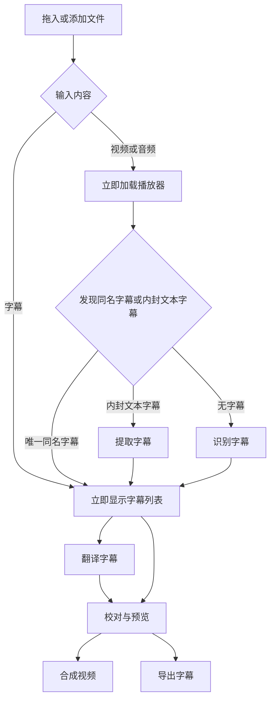

# 界面与操作规范

状态：实施规格 · 2026-10-28

## 1. 目标与组件边界

**打开就是工作台。添加后就能看到内容。识别、翻译、合成各有一个明确动作。**

技术路线使用 MyGo 原生 UI。控件、菜单、对话框、表格、分隔面板和主题直接复用框架；图标采用一套许可明确的成熟图标库，由 `ui.Icon` 渲染。不自绘控件、SVG 图标、字符图标、装饰性标识或欢迎插图。视频与 ASS 渲染视图只负责媒体内容，不承载另一套 HTML/CSS 工作台。

Concat 的实际工作台是布局与编辑交互标杆：画面、编辑和属性同屏，操作集中，内容占据主要空间。复用边界见 [源码核查](research/implementation-reuse.md)。

## 2. 唯一主流程

字幕入口同时查找唯一同名视频；未找到时保持纯字幕流程，不阻塞翻译或字幕导出。视频入口没有字幕也立即可播放，不等创建工程或下载模型。

- 没有“准备页”“开始使用页”或强制创建工程向导。
- 添加按钮和整个内容区的原生拖放进入同一个导入服务。
- 自动建立本地恢复工程；用户无需先命名或选择工程目录。另存工程是独立操作。
- 首次缺少模型或翻译服务时，仅打开对应配置；配置完成返回同一工作台。后续沿用用户选择。
- “一键”指配置就绪后一次点击启动任务，不表示跳过付费范围、覆盖已有成果等必要确认。
- 有同名字幕不自动重新识别；有既有译文不自动覆盖。重新识别和重译形成可审阅结果。

## 3. 布局

### 宽窗口

采用 MyGo 的可调整分隔面板，不用嵌套卡片。

- **顶部工具栏**：添加文件、识别并翻译、清空工作台、设置、导出字幕、合成视频。“识别并翻译”位于添加文件旁；失败或取消后显示“继续处理”，复用已完成的识别及译文。识别阶段本身中断时重新识别，不声称引擎支持任意分块断点。清空工作台先确认，不删除任何文件。不设“文件”菜单和工程入口。
- **上部主区**：左侧播放器，右侧字幕列表；列表用居中的“原始字幕 / 重建字幕”标签切换。原始字幕保留识别或导入时的分段；重建字幕在同一条目中上下显示重建字幕和译文。尚无译文时留空，不回填原文冒充译文。行高随内容自适应，多行字幕完整显示；序号列标题为“#”。
- **播放器**：背景固定为黑色，窗口底色同为黑色，快速拖动分隔条时不露白。视频在画面区域居中。文件名在播放器上方居中，不显示“预览”标题。进度条横跨画面宽度，下方依次为后退 15 秒、播放/暂停、前进 15 秒、播放速度（0.5×–2×，网页视频不支持倒放）、当前时间/总时长，右端为静音按钮和音量滑块（默认 50%）；图标在按钮内居中，按钮保留工具提示和读屏名称。音量与静音状态自动记忆。单击画面播放/暂停；右键菜单使用 MyGo 原生菜单（播放/暂停、后退 15 秒、前进 15 秒、静音），随界面语言显示，不出现 WebView2 网页菜单。
- **下部主区**：字幕编辑、字幕样式、识别与翻译三个同级区域并排，默认宽度 2:2:1，分隔面板的位置自动记忆。字幕编辑和字幕样式标题居中，开始、结束、时长整组居中。时间、字体、颜色和边距等短参数优先同行；空间不足时按组换行。
- **识别与翻译**：“语音识别”“AI 翻译”两个标签。每个标签最上方是一个全宽主按钮（“开始识别字幕”“开始翻译字幕”）。识别页直接选择现有 OneAsr 本地模型；翻译页直接选择已保存的供应商和模型。源语言、运行后端、文件格式、分块时长、最大 Token、保存目录与标点选项按组紧凑排列；目录与选择按钮相邻。翻译页另有目标语言、风格和时间轴重建选项。账号、模型管理及强制对齐模型保留在设置中，标签底部提供直达按钮。任务运行时切换模型供下一次任务使用。
- **字幕样式**：文字、外观、布局三组按内容宽度并排，组间以浅色竖线分隔，剩余宽度平均分配到分隔线两侧，铺满区域；放不下时换行，行间以横线分隔。
- **字幕样式**：按文字、外观、布局分组，使用 SmartSub 的预设、字体、字号、颜色、粗体/斜体/下划线、描边、阴影、背景框、透明度、左/右/垂直边距和位置。所有参数自动更新 JASSUB 预览；连续输入合并刷新，旧结果不能覆盖新参数，同一字体集不重建渲染器。预设可“保存为新预设”，用户预设可重命名和删除，内置预设不被修改。边框样式选“描边”时只显示描边与阴影参数，选“背景框”时只显示背景框边距、颜色和不透明度。背景框边距按字形实际上下沿计算，四边相同。
- **底部状态**：错误提示显示 8 秒后恢复为上一条状态。状态栏固定高度，文件选择窗口使用其自身的取消操作，不显示“取消任务”；后台处理按钮的显隐不能挤压上方工作区。合成进度与取消操作在播放器区域显示。没有任务时不常驻开发说明、限制宣言或宣传语。

视频出现真实首帧才称画面就绪；播放控件须控制实际媒体。文件名只作辅助信息，不能代替播放器。预览失效时就地显示短错误和重试动作，字幕仍可编辑。

### 窄窗口和缩放

按 CSS 等效逻辑宽度/DIP 布局，不按物理像素判断。约 1100 以下收起常驻属性列；约 700 以下上播放器、下单列字幕，原译文在同一条目内上下排列。320 逻辑像素下主要动作与错误可换行，无整页横向滚动。宽表格的横向滚动仅限表格内部。

首次窗口采用当前显示器的可用区域（已扣除任务栏、以 DIP 计）：目标宽度为 88%、高度为 90%，超宽屏限制窗口宽高比，避免内容被拉成长条；不重复除以显示缩放。后续通过 MyGo `StateKey` 恢复用户调整过的位置与大小。

100%/150%/200% 缩放下分别测量文字、点击区、列表和弹窗。默认沿用 MyGo 字体、主题及焦点样式；不为模拟截图而压小字号。正文 15–16 DIP，必要辅助文字不低于 13 DIP。

## 4. 导入与关联

| 输入或状态 | 直接可见的结果 |
| --- | --- |
| 添加视频，有唯一同名字幕 | 播放器和字幕列表一起加载，无第二次选择 |
| 添加字幕，有唯一同名视频 | 字幕列表和播放器一起加载 |
| 添加纯字幕 | 立即可校对、翻译、导出，不显示无意义的黑色视频 |
| 添加纯音频 | 音频播放与波形，不生成黑色视频 |
| 同时添加一对文件 | 去重后一次导入，显式选择优先 |
| 多个同名候选 | 主文件先可用；用小型候选菜单选择关联文件，不进入单独准备流程 |
| 候选损坏或不可读 | 主文件保留，在对应区域提示“关联失败”，可更换 |
| 新输入补齐缺失的视频或字幕 | 关联到当前工程；有多个目标时才询问 |
| 新输入将替换内容 | 先提交草稿，再打开新恢复工程；已有工程不被覆盖 |

名称和目录规则沿用 [产品契约](product-plan.md)。不因自动关联启动识别、翻译、下载或上传。重开工程恢复保存的关联，不重新猜测同名文件。

## 5. 字幕编辑

- 主列表按原始字幕或重建字幕显示各自的时间轴；重建字幕、译文和来源范围处于同一条目，不靠两套行号猜对应关系。序号列按当前字幕集的最大序号、字体与内边距测量，筛选不缩小序号容量。
- 字幕操作菜单支持在所选行前/后插入、删除所选字幕；原始与重建字幕分别操作，序号自动连续重排，支持撤销/重做。Delete 只在字幕列表获得焦点时删除所选行；受保护的 ASS 绘图不能删除。插入窗口尺寸固定，原始字幕不显示译文输入，但保留相同空间。
- 点时间定位媒体；点文字编辑，不因输入光标移动反复跳视频。空格键播放/暂停；文本输入框、已聚焦控件和对话框保留各自的原生按键行为。
- 字幕编辑实时修改字幕列表：停止输入约 0.6 秒或离开当前字幕时写入列表，可撤销；中文组合输入结束前不写入。时间或文字无效时保留输入并就地提示；离开该字幕则恢复原内容并说明原因。
- 字幕列表提供“保存”（覆盖原字幕文件，支持 Ctrl+S）和“另存为”；有未保存修改时显示“未保存”。没有原字幕文件时，“保存”打开保存对话框。打开文件或工程、重新识别、清空工作台和退出前，提供“保存／不保存／取消”；隐藏到托盘不询问。写入失败保留修改并阻止原动作。翻译、合成和导出前先把草稿写入列表。样式和偏好自动记忆。
- 编辑区内容第一行居中显示“序号 N”，撤销、重做按钮位于标题行右侧。文本框不加可见标题，只保留读屏名称。
- 重建字幕的编辑区用“原文 / 译文”切换正在编辑的文字，共用重建后的开始和结束时间；原始字幕的编辑区只操作原始轨。
- 翻译中断后保留已显示的完整与未完成文字，并提供“重试”。重启恢复同一现场；重试只补齐未完成字幕。进度中的未完成文字不能保存为成品。
- 导出内容明确列出“原始字幕”“重建字幕”“译文字幕”“双语字幕”。默认文件名分别带 `original`、`rebuilt-source`、`translated`、`bilingual`，便于核对。译文自动保存、列表保存和另存为只写译文；在重建字幕页打开导出时默认选择译文字幕。
- 导出对话框提供“保留字幕行”：全部字幕行、仅上行字幕、仅下行字幕。导入双语字幕时按每条字幕的第一行或最后一行提取，已有单行字幕保持不变；不推测语言。SRT/VTT 的换行及 ASS/SSA 的 `\\N`、`\\n` 按字幕格式处理，时间、内联样式、VTT 标识/设置和 ASS 非文字字段保留，原文件不变。单行导出文件名另带 `upper` 或 `lower`。选项切换不改变对话框尺寸。
- 手改译文后锁定该句译文，重新翻译不覆盖；修改原文不锁定，修正后仍可翻译。改时间锁时间，拆合锁分段。至少 200 组撤销；一次手势/批量替换对应一个撤销点。切页和选择不进入编辑历史。
- 搜索替换先显示匹配范围，拆合显示实际来源和时间；无时间锚点不按字数自动切轴。
- 自动结果可接受、需要确认或失败。旧结果与手改冲突时显示差异，不抢写。
- 视频播放时字幕列表跟随当前句；手动滚动后，下一句开始时回到当前句。正在输入时不切换编辑中的字幕，列表仍滚动。虚拟列表不能回收正在编辑或拥有键盘焦点的控件。
- 保留 ASS 标签、既有换行、绘图、Comment、层和有意重叠。不能编辑的对象提供只读查看，不静默删掉。

## 6. 设置

设置使用 MyGo 原生对话框，分为常规、识别与模型、翻译；输出参数位于合成对话框。各页内容区固定同高，使用功能分组标题、分隔线和统一间距；短参数同行或双列排列。正常窗口下尽量不出现滚动条；仅小屏或放大文字导致内容超出可用高度时保留滚动，不能裁掉控件。模型区一次显示所选模型的目录、状态与操作，通过选择器切换全部模型，不纵向堆叠八套重复按钮。

### 常规与托盘

常规页提供界面语言：跟随系统、简体中文、English，默认跟随系统，切换后立即生效。

关闭主窗口可选 **直接退出** 或 **最小化到托盘**，默认直接退出。选择托盘后，关闭隐藏窗口并保留任务；单击或双击托盘图标打开主窗口，托盘菜单提供“打开 OneSub”“退出”。启动失败或托盘创建失败不能把程序藏到无法恢复的状态。

真正退出时，有任务则提供“等待完成”“取消任务并退出”“返回”。工程保留；有未保存的字幕修改时，先提供“保存／不保存／取消”。托盘退出与窗口退出共用一套处理，不绕开检查；任务结束不擅自弹回主窗口。

### 识别与模型

对照 OneAsr 源码提供：

- Qwen3-ASR 0.6B/1.7B 及可用 FP16/INT8 变体。
- CTC/Qwen 对齐器；明确当前选择和实际目录。
- 自动/GPU/CPU 后端、源语言、分块时长；默认 60 秒，范围 30–180 秒。
- 适用的简繁输出、字幕长度及高级解码参数。
- HTDemucs 人声分离、SenseVoiceSmall 热词作为独立可选项；不默认下载，不对不支持语言启用。
- 每个模型显示大小、目录、下载/校验状态；提供下载、取消、续传/重试、选择本地目录及验证。
- 下载位置、就绪检查和实际加载使用同一模型映射。切换模型不忘掉各自路径，不删除旧模型。

下载失败显示原因和重试动作；完成必须以文件和哈希校验为准。不得伪造百分比或把半成品标为已安装。

### 翻译

服务、模型、端点、Key、目标语言、术语和预算有明确作用域。并发批数与每批字幕数可保存，默认分别为 2 和 20；已有字符预算、检查和恢复流程保持不变。服务地址编辑结束后自动获取当前服务的模型列表，可刷新；使用可输入下拉框，接口不支持列表时保留手工模型名。不改用其他服务，不自动转发重定向。Key 交给系统凭据设施，不保存到工程或日志。首次设置后，正常点击“翻译字幕”使用已选服务。发送前用短确认写清服务、内容范围及费用估算；不自动更换账号或端点。

### 输出与存储

区分工程、模型、缓存和输出目录。缓存清理不删除工程或模型；模型删除不影响已生成字幕。支持输出位置、容器、字幕模式、语言轨、基础字体/位置/描边和编码质量。

## 7. 合成与导出

“合成视频”使用标准模式名称：**软字幕（封装）**、**硬字幕（烧录）**。字幕文件导出为次级独立动作，不要求生成视频；可导出原文、译文或双语字幕，双语可选语言顺序与主字幕，ASS 双语使用独立主次样式。

- 软字幕：MKV 保留 ASS；MP4 使用 mov_text，样式损失就地说明并确认。
- 硬字幕：SDR 视频重编码，默认保留兼容音轨。HDR 烧录不在 P0 中假称支持。
- 编码质量提供“原画质（无损）”和 CRF 18、20、23。原画质使用 H.264 无损编码（QP 0）并尽量保留源像素格式，字幕以外的画面与原视频一致，文件很大；有损档位显示实际 CRF，不称为“原画质”。字幕模式与编码质量自动记忆。提供“导出 5 秒预览”和“开始合成”；预览片段不能代替完整产物检查。
- 合成时播放器区域显示阶段、真实 FFmpeg 进度和取消按钮；哈希和完整解码校验用不定进度，不伪造百分比。完整输出默认 `原视频名-OneSub.mp4` 或 `.mkv`，预览片段另加 `-preview`。
- 预检只呈现当前实际问题：非法时间、缺字、不能保留的流、目标冲突和空间不足等。
- 完成后提供播放结果、打开目录、查看检查报告。不将仅生成 partial 文件显示为完成。
- 预览和合成共用同一版本字幕与字体。任务启动后继续编辑不能改变其冻结输入。

## 8. 文案

界面提供简体中文和英文，默认跟随系统语言；菜单、对话框、错误提示和托盘菜单随界面语言显示。同一动作固定名称，按钮用动词，状态用可观察结果。提示优先给动作，不在每个区块重复原理。

| 场景 | 提示 |
| --- | --- |
| 空播放器 | 添加视频 |
| 模型缺失 | 下载识别模型 |
| 来源移动 | 视频已移动 · 重新定位 |
| 保存失败 | 保存失败，修改仍在 · 重试 |
| 关联候选失败 | 关联失败 · 更换文件 |
| 翻译结果过期 | 内容已修改 · 查看差异 |
| 翻译请求结果未知 | 请求结果未知，可能已计费 · 核对后重试 |
| 导出目标已存在 | 文件已存在 · 更换名称 |

具体错误可展开详情，显示可复制错误码。没有错误时不常驻这些说明。用户指南承担解释，工作台承担操作。

## 9. 验收

1. 四种入口分别测拖入视频、添加视频、拖入字幕、添加字幕；唯一同名配对无需第二次选择，视频可播放和暂停。
2. 无模型、无 Key 可导入、手改、撤销、保存、重开和导出。不是禁用所有按钮后显示长篇限制。
3. 首次模型下载→识别、首次服务配置→翻译、合成样片→全片均在同一工作台上下文完成。
4. 原生控件测试覆盖按钮、表格选择、输入、焦点、对话框；桌面实测覆盖文件对话框、拖放、媒体帧、托盘和关闭恢复。
5. 仅键盘完成主要路径；NVDA 能读出字幕、选中状态、输入错误和进度。文字对比度至少 4.5:1，控件/大文字至少 3:1，状态不只靠颜色。
6. 浅深色、100%/150%/200% 缩放、长文件名、长译文、混合 RTL/LTR、20,000 条字幕分别验证。常用操作点击区目标 32 DIP。
7. 至少 5 名未参与开发的用户测试，至少 4 人在 8 分钟内独立完成短样例的导入、改句和导出；另测识别、翻译、合成用途是否能正确选择，下载时间单列。

单元测试、源码分析和截图好看都不能替代以上操作验收。未完成项在验收记录中明示，不将其标为产品已可用。
